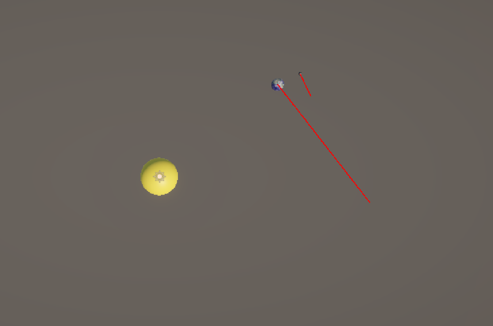

# Mod4-02 · Sistema solar básico

Ejercicio 2 del Módulo 4 (C# Avanzado I): Transform y manipulación de objetos 3D desde scripts.



## Jerarquía

```
Sun
└── Earth
    └── Moon
```

La Tierra es hija del Sol y la Luna es hija de la Tierra, así que la posición de cada hijo es relativa a su padre. Los hijos también heredan la escala del padre, por lo que sus valores locales están compensados para que en el mundo el Sol mida 3, la Tierra 1 y la Luna 0,3.

| Objeto | Posición local | Escala local | `rotationSpeed` | `orbitSpeed` |
|---|---|---|---|---|
| Sun | (0, 0, 0) | 3 | 3 | 0 |
| Earth | (4, 0, 0) | 0,33 | 50 | 20 |
| Moon | (2, 0, 0) | 0,3 | 10 | 28 |

## Script `CelestialBody`

Un único script compartido por los tres cuerpos. En cada `Update()`:

- Gira el objeto sobre su eje Y con `transform.Rotate`.
- Si tiene padre, lo hace orbitar a su alrededor con `transform.RotateAround`.
- Dibuja con `Debug.DrawRay` un rayo rojo en la dirección del movimiento orbital, calculada con el producto vectorial entre el eje Y y el vector que va del padre al cuerpo.

Todos los movimientos se multiplican por `Time.deltaTime`, así que la velocidad no depende del framerate.

Como un hijo gira junto con su padre, la velocidad orbital real es la suma de su `orbitSpeed` y la `rotationSpeed` del padre: la Tierra orbita a 23°/s (3 + 20) y la Luna a 78°/s (50 + 28), por lo que la Luna da varias vueltas a la Tierra por cada vuelta de la Tierra al Sol.

## Cámara

Situada en (0, 25, 0) mirando hacia abajo, para ver la órbita completa de la Tierra desde arriba.
